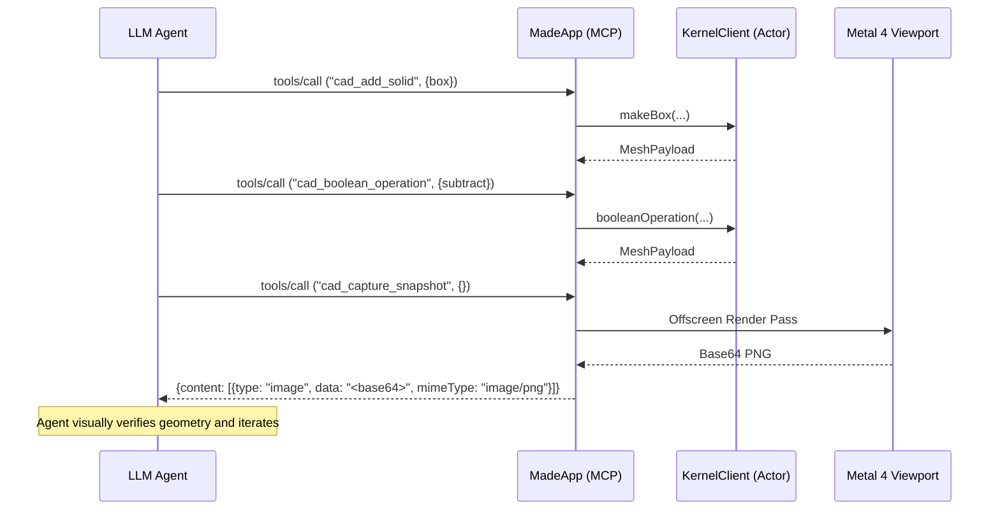

# Agent API & Model Context Protocol (MCP)

`made` integrates first-class autonomous AI agent capabilities into the core application. Agents can inspect the 3D scene, create and modify parametric geometry, execute boolean operations, script models using a declarative Swift DSL, and request a viewport snapshot. The snapshot works in the GUI and over `--mcp-stdio`.

---

## Architecture Overview

```
┌────────────────────────────────────────────────────────┐
│           External Agents (Claude, Cursor, CLI)        │
└──────────────────────────┬─────────────────────────────┘
                           │ JSON-RPC 2.0 (stdio or local TCP)
┌──────────────────────────▼─────────────────────────────┐
│                       MCPServer                        │
│   • Conforms to MCP Spec (2024-11-05)                  │
│   • Methods: initialize, tools/list, tools/call        │
│   • Notifications (no id) receive no response          │
└──────────────────────────┬─────────────────────────────┘
                           │ Tool Invocations
┌──────────────────────────▼─────────────────────────────┐
│                    CADToolRegistry                     │
│   • cad_get_scene            • cad_remove_solid        │
│   • cad_add_solid            • cad_measure             │
│   • cad_set_param            • cad_boolean_operation  │
│   • cad_set_transform        • cad_capture_snapshot    │
└──────────────┬──────────────────────────┬──────────────┘
               │ Live Mutation            │ Snapshot Request
┌──────────────▼─────────────┐ ┌──────────▼──────────────┐
│       DocumentModel        │ │      MetalRenderer      │
│   (@Observable Scene Graph)│ │ (Offscreen PNG, GUI only)│
└────────────────────────────┘ └──────────┬──────────────┘
                                          │ Base64 Image
                               ┌──────────▼──────────────┐
                               │ Multimodal Vision Loop  │
                               │ (Visual Inspection)     │
                               └─────────────────────────┘
```

---

## 1. Model Context Protocol (MCP) Integration

`made` implements the Model Context Protocol natively in pure Swift ([`MCPProtocol.swift`](../../macos/Sources/MadeCore/Agent/MCPProtocol.swift) and [`MCPServer.swift`](../../macos/Sources/MadeCore/Agent/MCPServer.swift)).

### Headless Stdio Transport
The application executable can run as an MCP server over standard input and output:

```sh
cd macos
swift run MadeApp --mcp-stdio
```

This mode is not fully headless. `MadeApp.init` starts the server task, and the SwiftUI window scene still launches. The server creates a fresh `DocumentModel` and `KernelClient`, and a `HeadlessSnapshotProvider` that owns an offscreen `MetalRenderer`. Each `cad_capture_snapshot` call tessellates the document as it stands at the call, drops meshes for removed solids, and renders the frame. Without a Metal 4 device the registry has no provider, and the tool returns an `isError` result naming the missing device while the server keeps serving. The process exits when standard input closes.

The server reads standard input in 64 KB chunks and splits each chunk on newlines. A message larger than one chunk is split and fails to parse (#101).

### In-App TCP Transport
The MCP popover (the sparkles toolbar button) starts a TCP listener inside the running GUI. `WorkspaceModel.toggleMCPServer` calls `MCPServer.start(port:)`, and the default port is 9820. The listener serves the same JSON-RPC 2.0 methods as the stdio transport.

The listener shares the window's own `DocumentModel`, `KernelClient`, and `MetalRenderer`. An agent connected over TCP therefore edits the document that the window shows, and `cad_capture_snapshot` works. Tool calls change the document, so the Navigator and Inspector update through `@Observable`. The tool registry has no viewport redraw call, and the window redraws a removed solid through `WorkspaceModel.syncMeshes` (AGENT-25).

**Requirement (user decision, 2026-10-11).** The listener must accept connections only from the local machine (loopback). The MCP popover already displays the address as `127.0.0.1:9820`.

**Known gap.** `MCPServer.start` creates `NWListener(using: .tcp, on: port)` with no interface restriction, so the listener binds to all interfaces. Another host on the network can reach it. DSN-f5402406 (#129, issue number pending) tracks restricting the bind to loopback.

### Configuration for Claude Desktop / Cursor
Add `made` to your `claude_desktop_config.json`:

```json
{
  "mcpServers": {
    "made-cad": {
      "command": "/path/to/made/macos/.build/debug/MadeApp",
      "args": ["--mcp-stdio"]
    }
  }
}
```

---

## 2. Core CAD Tools

The [`CADToolRegistry`](../../macos/Sources/MadeCore/Agent/CADTools.swift#L8) provides 8 tools. Argument names below match the input schemas in `CADTools.swift`:

| Tool Name | Parameters | Description |
| --------- | ---------- | ----------- |
| `cad_get_scene` | None | Returns the full scene hierarchy, object IDs, parametric dimensions, and 3D positions in JSON format. |
| `cad_add_solid` | `type` ("box" \| "cylinder"), dimensions (`width`, `depth`, `height`, `radius`), position (`posX`, `posY`, `posZ`) | Instantiates a new parametric solid in the document. Positions must be finite numbers from -10000 to 10000 mm (`DocumentLimits.position`) and default to 0 when omitted. Sizes must be finite numbers and are clamped to `DocumentLimits`. A wrong-typed (including `null`) or non-finite argument, or an out-of-bound position, returns an `isError` result and adds nothing. |
| `cad_set_param` | `id`, `param` (box: "width", "depth", "height"; cylinder: "radius", "height"), `value` | Updates a parameter on a solid, clamped to the `DocumentLimits` ranges. An unknown `param` for the solid kind, an imported solid, an unknown solid ID, and a non-finite `value` return an `isError` result and change nothing. The success message reports the stored (clamped) value. |
| `cad_set_transform` | `id`, `posX`, `posY`, `posZ` | Updates the world position of a solid. Positions must be finite numbers from -10000 to 10000 mm (`DocumentLimits.position`), and omitted coordinates are unchanged. A wrong-typed (including `null`) or non-finite argument, an out-of-bound position, or an unknown solid ID returns an `isError` result and changes nothing. |
| `cad_remove_solid` | `id` | Deletes a solid from the document. |
| `cad_measure` | `id` | Returns calculated volume, bounding extents, and estimated surface area. |
| `cad_boolean_operation` | `solidA` (target), `solidB` (cutter), `operation` ("subtract" \| "union" \| "intersect") | Runs a CSG boolean in the kernel. An operand ID not in the document, or the same ID for both operands, returns an `isError` result that names the ID and changes nothing, before the kernel is called. An operand removed while the kernel runs also returns `isError` and adds nothing. The kernel returns `unknown-solid` for a solid in the document with no kernel mesh, such as an imported solid. The result is recorded as an `.imported` object under an ID different from the kernel's `csg-` ID, so other tools cannot use the reported ID (#100). |
| `cad_capture_snapshot` | None | Renders an offscreen 800x600 Metal frame and returns it as MCP `image` content: raw base64 PNG with MIME type `image/png`, not a data URI. Over `--mcp-stdio` the document is tessellated before the render. |

### Error Behavior
A failing tool call returns a successful JSON-RPC response whose `result` has `isError: true` and a text message beginning `Error:`. JSON-RPC error payloads are limited to the following cases:

| Code | Condition |
| ---- | --------- |
| -32700 | Input that is not valid UTF-8 or not decodable as a request. This also covers structurally invalid requests, which should return -32600 (#95). |
| -32601 | Unknown method. |
| -32602 | `tools/call` without `params.name`. |
| -32603 | Result encoding failure. |

A message with no `id` member and a string `method` is a notification and receives no response. A message with `"id":null` is a request and receives a response. A `notifications/initialized` message sent with an `id` is a request for an unserved method and returns -32601.

---

## 3. Multimodal Visual Verification Loop

Visual checks catch artifacts that measurements miss, such as inverted normals or incorrect clearances. The loop works against the running GUI, where the registry holds the window renderer as its snapshot provider. The loop also works over `--mcp-stdio`, where an offscreen renderer serves the snapshot.

### The Agent Verify Cycle


---

## 4. Cadova-Inspired Declarative CAD DSL

In addition to discrete MCP tool calls, agents can generate complete CAD models programmatically using the declarative Swift DSL in [`CADDSL.swift`](../../macos/Sources/MadeCore/Scripting/CADDSL.swift):

```swift
import MadeCore

// Declarative CSG modeling with native operators:
let mountingBracket = Box(width: 50, depth: 50, height: 10)
    - Cylinder(radius: 6, height: 20)
    + Box(width: 10, depth: 10, height: 5).translated(x: 20)

// The tree crosses to the kernel actor as one request; the DSL itself runs no CSG.
let result = await mountingBracket.evaluate(on: kernel, solidId: SolidId("bracket"))
```

### DSL Features
- **Operator Overloads**: `-` for CSG subtraction, `+` for CSG union, and `&` for intersection.
- **Fluent Transforms**: `.translated(x:y:z:)` and parameter setters.
- **Result Builders**: `@CADShapeBuilder` allows composite hierarchy definitions.

---

## Open Decisions

These questions have no decision yet. Each links to an architecture decision record (ADR) or backlog item by issue number.

- #132: Whether an agent drives the open document (the window's session) or a separate session. Today the TCP transport shares the window document, and `--mcp-stdio` does not.


---

## Decided

- ADR-D6 (#148) is decided. Part files are TypeScript with a brepjs-style API, run by JavaScriptCore inside the app ([ADR-D6](./adr/ADR-D6-scripting-runtime.md), #435). External agents edit the files, and the app reloads them (#427). Agents inspect the result over MCP (#428).

---

## Related Documentation

- [`rendering.md`](./rendering.md): Snapshot generation pipeline
- [`kernel.md`](./kernel.md): CSG boolean execution
- [`document-model.md`](./document-model.md): Scene mutation APIs
