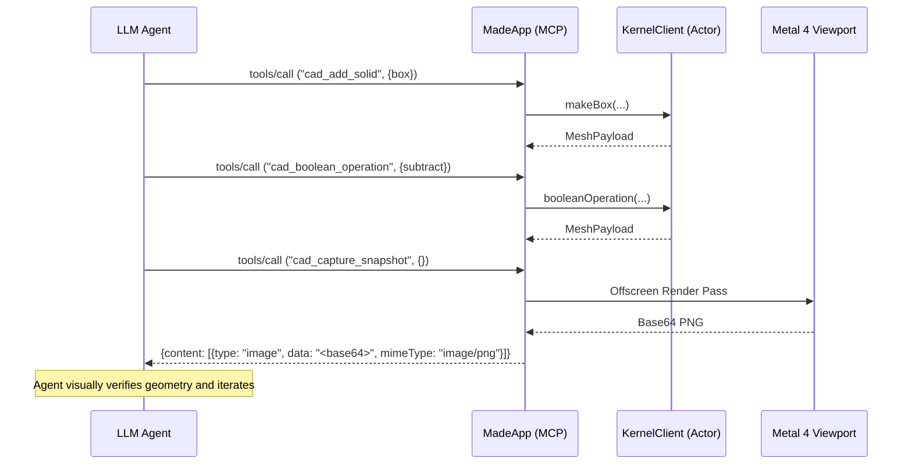

# Agent API & Model Context Protocol (MCP)

`made` integrates first-class autonomous AI agent capabilities into the core application. Agents can inspect the 3D scene, create and modify parametric geometry, execute boolean operations, script models using a declarative Swift DSL, and request a viewport snapshot. The snapshot works in the GUI and over `--mcp-stdio`.

---

## Architecture Overview

```
┌────────────────────────────────────────────────────────┐
│           External Agents (Claude, Cursor, CLI)        │
└──────────────────────────┬─────────────────────────────┘
                           │ JSON-RPC 2.0 (stdio or local TCP)
┌──────────────────────────▼─────────────────────────────┐
│                       MCPServer                        │
│   • Conforms to MCP Spec (2024-11-05)                  │
│   • Methods: initialize, tools/list, tools/call        │
│   • Notifications (no id) receive no response          │
└──────────────────────────┬─────────────────────────────┘
                           │ Tool Invocations
┌──────────────────────────▼─────────────────────────────┐
│                    CADToolRegistry                     │
│   • cad_get_scene            • cad_boolean_operation  │
│   • cad_add_solid            • cad_reload             │
│   • cad_set_param            • cad_get_diagnostics    │
│   • cad_set_transform        • cad_verify             │
│   • cad_remove_solid         • cad_capture_snapshot    │
│   • cad_measure                                        │
└──────────────┬──────────────────────────┬──────────────┘
               │ Live Mutation            │ Snapshot Request
┌──────────────▼─────────────┐ ┌──────────▼──────────────┐
│       DocumentModel        │ │      MetalRenderer      │
│   (@Observable Scene Graph)│ │ (Offscreen PNG, GUI only)│
└────────────────────────────┘ └──────────┬──────────────┘
                                          │ Base64 Image
                               ┌──────────▼──────────────┐
                               │ Multimodal Vision Loop  │
                               │ (Visual Inspection)     │
                               └─────────────────────────┘
```

---

## 1. Model Context Protocol (MCP) Integration

`made` implements the Model Context Protocol natively in pure Swift ([`MCPProtocol.swift`](../../macos/Sources/MadeCore/Agent/MCPProtocol.swift) and [`MCPServer.swift`](../../macos/Sources/MadeCore/Agent/MCPServer.swift)).

### Headless Stdio Transport
The application executable can run as an MCP server over standard input and output:

```sh
cd macos
swift run MadeApp --mcp-stdio
```

This mode is not fully headless. `MadeApp.init` starts the server task, and the SwiftUI window scene still launches. The server creates a fresh `DocumentModel` and `KernelClient`, and a `HeadlessSnapshotProvider` that owns an offscreen `MetalRenderer`. Each `cad_capture_snapshot` call tessellates the document as it stands at the call, drops meshes for removed solids, and renders the frame. Without a Metal 4 device the registry has no provider, and the tool returns an `isError` result naming the missing device while the server keeps serving. The process exits when standard input closes.

The server reads standard input in 64 KB chunks and passes each chunk to `MCPLineFramer`, which buffers bytes until a newline completes a message. A message may be larger than one read, and a read may end inside a multi-byte character. A line that is not valid UTF-8 gets one -32700 response. Input that ends without a newline is processed as a final line. The TCP transport frames each connection the same way, answers its lines in arrival order, and closes the connection after the last response is sent.

A line may hold at most 16 MiB (`MCPLineFramer.defaultMaximumLineLength`, 16,777,216 bytes). The framer stops buffering as soon as a line passes the limit, so a peer that never sends a newline cannot grow memory without bound. The oversized line gets one -32700 response with a null `id`. Over stdio, the server skips the rest of that line and keeps serving. Over TCP, the server closes the connection after the -32700 and answers nothing sent after the oversized line.

### In-App TCP Transport
The MCP popover (the sparkles toolbar button) starts a TCP listener inside the running GUI. `WorkspaceModel.toggleMCPServer` calls `MCPServer.start(port:)`, and the default port is 9820. The listener serves the same JSON-RPC 2.0 methods as the stdio transport.

The listener shares the window's own `DocumentModel`, `KernelClient`, `PartReloadController`, and `MetalRenderer`. An agent connected over TCP therefore edits the document that the window shows, and `cad_capture_snapshot` works. Tool calls change the document on `@MainActor`, so the Navigator and Inspector update through `@Observable`, and `CADToolRegistry` installs meshes, updates transforms, removes meshes, and invalidates the viewport through the shared `SolidMeshSink` (AGENT-25, #132).

**Interface restriction (user decision, 2026-10-11).** The listener accepts connections only from the local machine (loopback). `MCPServer.start` configures `NWParameters.tcp` with `requiredInterfaceType = .loopback`, restricting listener interfaces to `127.0.0.1` and `::1`. Any connection attempt targeting a non-loopback network address is refused (#129). The MCP popover displays the address as `127.0.0.1:9820`.

**Connection tracking and stop lifecycle (user decision, 2026-10-14).** Every accepted `NWConnection` is tracked in `MCPServer.activeConnections` under an `NSLock`. Stopping the server (`MCPServer.stop()`) atomically drains and cancels all tracked connections, cancels their per-connection consumer tasks and stream continuations, and closes the TCP sockets. In-flight tool responses are suppressed upon stop so cancelled connections emit no response data. Sockets closed or failed by the remote peer are automatically removed from the tracking table. Server state `isRunning` transitions to `false` and triggers `onStateChange?(false)` after listener and connection cancellation complete, ensuring disconnected clients cannot mutate the document after the GUI stops the server (#130).

**Port conflict and bind error handling (user decision, 2026-10-14).** Port values are validated before starting; invalid ports (e.g. port 0) throw `MCPServerError.invalidPort`. `MCPServer.start(port:)` synchronizes the initial listener start state via a `DispatchSemaphore` with a 500ms timeout and transitions `isRunning` to `true` and notifies `onStateChange?(true)` only when the listener reaches `.ready`. If another process occupies the port (e.g. port 9820 is in use), the listener transitions to `.failed` with an `NWError` (e.g. POSIX error 48: Address already in use). The error is recorded in `MCPServer.lastError` and forwarded via `MCPServer.onError` to `WorkspaceModel.mcpServerError`. `WorkspaceModel` logs the error and suppresses "Started" console logs for failed attempts. The MCP popover displays `Off — <error>` in red with the toggle remaining off until retry. When the port is freed, retrying clears `mcpServerError` and starts cleanly (#133).

**Request ordering, send failure logging, and consumer cancellation (user decision, 2026-10-14).** Each accepted TCP connection is framed through `MCPLineFramer` into an `AsyncStream` consumed by a dedicated serial consumer task. Requests received on a single connection—whether pipelined in one read or received across separate chunk writes—are processed strictly in arrival order and their responses are transmitted in request order. Slower requests delay subsequent responses on that connection without reordering or concurrency racing. Notifications (JSON-RPC requests lacking an `id`) produce no response and do not disrupt or reorder adjacent request responses. Concurrent TCP connections operate independently and maintain per-connection FIFO response ordering. If a `connection.send` encounters an error, the failure is logged to Unified Logging (`com.made.app.MCP`) with the connection identity (`ObjectIdentifier(connection)`), surfaced to debug observers (`onSendFailure`), and tears down the connection. If the client closes the connection or the socket transitions to `.failed` or `.cancelled`, the connection is removed from tracking and the consumer task is cancelled immediately, abandoning unexecuted queued mutating requests without altering the document (#134).

### Configuration for Claude Desktop / Cursor
Add `made` to your `claude_desktop_config.json`:

```json
{
  "mcpServers": {
    "made-cad": {
      "command": "/path/to/made/macos/.build/debug/MadeApp",
      "args": ["--mcp-stdio"]
    }
  }
}
```

---

## 2. Core CAD Tools

The [`CADToolRegistry`](../../macos/Sources/MadeCore/Agent/CADTools.swift#L16) provides 11 tools. Argument names below match the input schemas in `CADTools.swift`:

| Tool Name | Parameters | Description |
| --------- | ---------- | ----------- |
| `cad_get_scene` | None | Returns the full scene hierarchy, object IDs, parametric dimensions, and 3D positions in JSON format. |
| `cad_add_solid` | `type` ("box" \| "cylinder"), dimensions (`width`, `depth`, `height`, `radius`), position (`posX`, `posY`, `posZ`) | Instantiates a new parametric solid in the document, schedules its 60 ms debounced kernel tessellation, and installs the resulting mesh in the viewport when a mesh sink is attached. Positions must be finite numbers from -10000 to 10000 mm (`DocumentLimits.position`) and default to 0 when omitted. Sizes must be finite numbers within `Float` range and are clamped to `DocumentLimits`. A wrong-typed (including `null`, `bool`, or string) or non-finite argument (including `Float` overflow), or an out-of-bound position, returns an `isError` result and adds nothing. The success message reports the solid ID, clamped dimensions, and world position (`Successfully added solid with ID: <id> with dimensions (...) at position (...)`). |
| `cad_set_param` | `id`, `param` (box: "width", "depth", "height"; cylinder: "radius", "height"), `value` | Updates a parameter on a solid, clamped to the `DocumentLimits` ranges, and schedules a debounced recompute and viewport redraw. An unknown `param` for the solid kind, an imported or boolean solid, an unknown solid ID, a locked solid ID, and a non-finite `value` return an `isError` result and change nothing. The success message reports the stored (clamped) value. |
| `cad_set_transform` | `id`, `posX`, `posY`, `posZ` | Updates the world position of a solid and updates its viewport mesh transform. Positions must be finite numbers from -10000 to 10000 mm (`DocumentLimits.position`), and omitted coordinates are unchanged. A wrong-typed (including `null`) or non-finite argument, an out-of-bound position, an unknown solid ID, or a locked solid ID returns an `isError` result and changes nothing. |
| `cad_remove_solid` | `id` | Deletes a solid from the document, stops any active part file watcher, removes its mesh from the viewport, and disposes its kernel cache entry. An unknown or locked solid ID returns an `isError` result and leaves the scene untouched. |
| `cad_measure` | `id` | Returns calculated volume, bounding extents, and surface area. |
| `cad_boolean_operation` | `solidA` (target), `solidB` (cutter), `operation` ("subtract" \| "union" \| "intersect") | Runs a CSG boolean in the kernel after settling any in-flight recomputes for `solidA` and `solidB`. An operand ID not in the document, or the same ID for both operands, returns an `isError` result that names the ID and changes nothing, before the kernel is called. An operand removed while the kernel runs also returns `isError` and adds nothing. The kernel returns `unknown-solid` for a solid in the document with no kernel mesh, such as an imported solid. On success the result is recorded as a `.boolean(op:solidA:solidB:)` object and installed as a mesh in the viewport. The reply reports its ID, `boolean-<seq>`, which the kernel also stores, so `cad_measure`, `cad_set_transform`, `cad_remove_solid` and `cad_get_scene` accept it. A kernel failure adds nothing and reports no ID. |
| `cad_reload` | `id` (optional), `file` (optional) | Re-evaluates an open `.part.ts` or `.part.js` part file immediately (or opens and evaluates a part file path when `file` is given, or reloads all open parts when both arguments are omitted). Returns structured evaluation metadata on success or an `isError` tool result containing the `file`, `line`, `column`, and `message` diagnostics on failure (#428). |
| `cad_get_diagnostics` | `id` (optional), `file` (optional) | Returns the last evaluation `errors` and `warnings` for open part files (or filtered by `id` or `file`), each with `file`, `line`, `column`, and `message` (#428). |
| `cad_verify` | `id` (optional) | Checks that each solid in the scene (or the solid matching `id`) is a valid `closed`, `manifold`, `positiveVolume` mesh, and compares measured `volume`, `area`, and `bounds` against any `export const expected` block in a part file within tolerance. Returns a structured verification report with `isError: true` when topological verification or any `expected` check fails (#428). |
| `cad_capture_snapshot` | `view` (optional: "front" \| "top" \| "right" \| "isometric" \| "perspective") | Renders an offscreen 800x600 Metal frame and returns it as MCP `image` content (raw base64 PNG with MIME type `image/png`). When `view` is specified, renders from that camera preset without modifying the interactive viewport camera (#89, #428). |

### Error Behavior
A failing tool call returns a successful JSON-RPC response whose `result` has `isError: true` (never a JSON-RPC error payload). JSON-RPC error payloads are limited to the following protocol cases:

| Code | Condition |
| ---- | --------- |
| -32700 | Input that is not valid UTF-8 or not decodable as a request. This also covers structurally invalid requests, which should return -32600 (#95). |
| -32601 | Unknown method. |
| -32602 | `tools/call` without `params.name`. |
| -32603 | Result encoding failure. |

A message with no `id` member and a string `method` is a notification and receives no response. A message with `"id":null` is a request and receives a response. A `notifications/initialized` message sent with an `id` is a request for an unserved method and returns -32601.

---

## 3. Multimodal Visual Verification Loop

Visual checks catch artifacts that measurements miss, such as inverted normals or incorrect clearances. The loop works against the running GUI, where the registry holds the window renderer as its snapshot provider. The loop also works over `--mcp-stdio`, where an offscreen renderer serves the snapshot.

### The Agent Verify Cycle


---

## 4. Cadova-Inspired Declarative CAD DSL

In addition to discrete MCP tool calls, agents can generate complete CAD models programmatically using the declarative Swift DSL in [`CADDSL.swift`](../../macos/Sources/MadeCore/Scripting/CADDSL.swift):

```swift
import MadeCore

// Declarative CSG modeling with native operators:
let mountingBracket = Box(width: 50, depth: 50, height: 10)
    - Cylinder(radius: 6, height: 20)
    + Box(width: 10, depth: 10, height: 5).translated(x: 20)

// The tree crosses to the kernel actor as one request; the DSL itself runs no CSG.
let result = await mountingBracket.evaluate(on: kernel, solidId: SolidId("bracket"))
```

### DSL Features
- **Operator Overloads**: `-` for CSG subtraction, `+` for CSG union, and `&` for intersection.
- **Fluent Transforms**: `.translated(x:y:z:)` and parameter setters.
- **Result Builders**: `@CADShapeBuilder` allows composite hierarchy definitions.

---

## 5. Claude Code Plugin and `made-cad` Skill

Repository-level Claude Code plugin manifests ([`.claude-plugin/marketplace.json`](../../.claude-plugin/marketplace.json), [`.claude-plugin/plugin.json`](../../.claude-plugin/plugin.json), and [`plugins/made-cad/.claude-plugin/plugin.json`](../../plugins/made-cad/.claude-plugin/plugin.json)) package the `made-cad` skill ([`plugins/made-cad/skills/made-cad/SKILL.md`](../../plugins/made-cad/skills/made-cad/SKILL.md)) (#429).

The skill provides external agents with:
- Documentation of the `.part.ts` and `.part.js` part format, coordinate system, centering rules, 2D sketches, sweeps, CSG booleans, transforms, `param` / `defineParams`, and the `export const expected` verification contract.
- A synchronized copy of the TypeScript declaration file at [`plugins/made-cad/skills/made-cad/references/made.d.ts`](../../plugins/made-cad/skills/made-cad/references/made.d.ts) for `tsc --noEmit` pre-flight validation.
- Connection instructions for `127.0.0.1:9820` (TCP) and `--mcp-stdio`, reference tables for all 11 MCP tools, and the step-by-step edit -> `cad_reload` -> `cad_get_diagnostics` -> `cad_verify` -> `cad_capture_snapshot` -> repair loop.
- A gallery of six verified `.part.ts` example parts under [`plugins/made-cad/skills/made-cad/examples/`](../../plugins/made-cad/skills/made-cad/examples/) and a five-case evaluation benchmark set under [`plugins/made-cad/skills/made-cad/eval/`](../../plugins/made-cad/skills/made-cad/eval/), validated in CI by [`PluginSkillTests.swift`](../../macos/Tests/MadeCoreTests/PluginSkillTests.swift).

---

## Open Decisions

These questions have no decision yet. Each links to an architecture decision record (ADR) or backlog item by issue number.

- #132: Whether an agent drives the open document (the window's session) or a separate session. Today the TCP transport shares the window document, and `--mcp-stdio` does not.


---

## Decided

- ADR-D6 (#148) is decided. Part files are TypeScript with a brepjs-style API, run by JavaScriptCore inside the app ([ADR-D6](./adr/ADR-D6-scripting-runtime.md), #435). External agents edit the files, and the app reloads them (#427). Agents inspect the result over MCP (#428) using the `made-cad` Claude Code plugin skill (#429).

---

## Related Documentation

- [`rendering.md`](./rendering.md): Snapshot generation pipeline
- [`kernel.md`](./kernel.md): CSG boolean execution
- [`document-model.md`](./document-model.md): Scene mutation APIs

