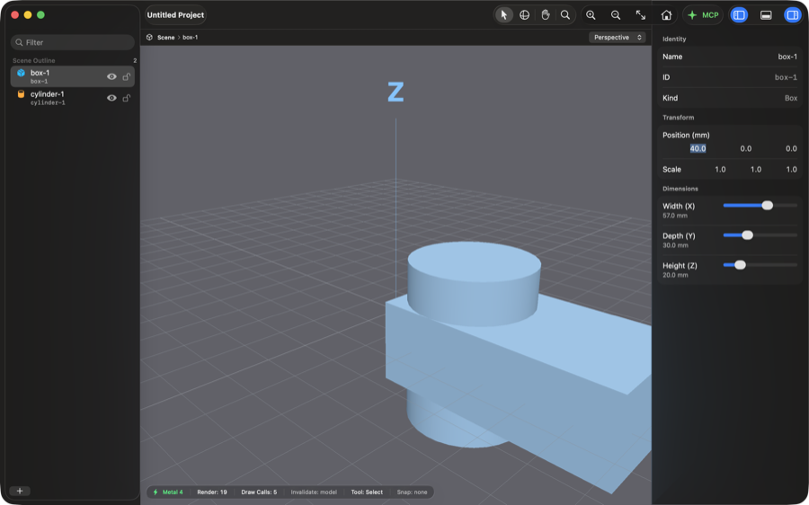
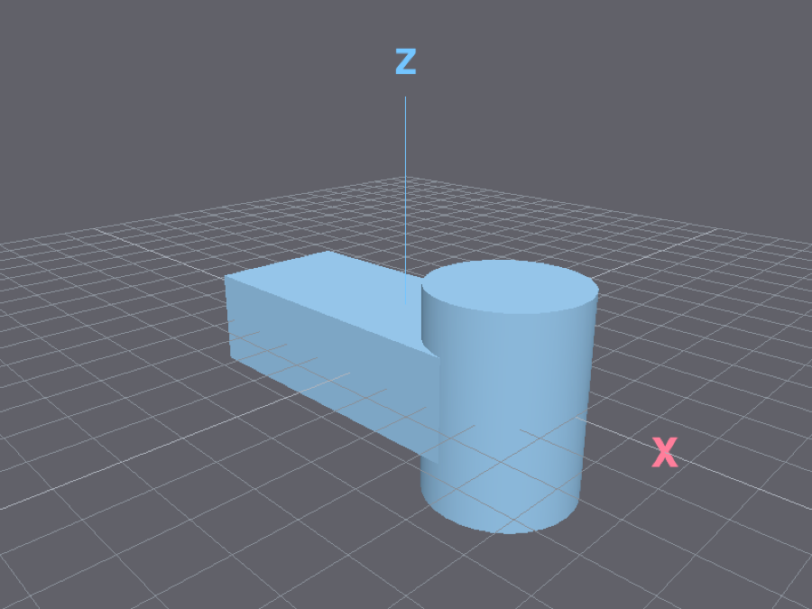
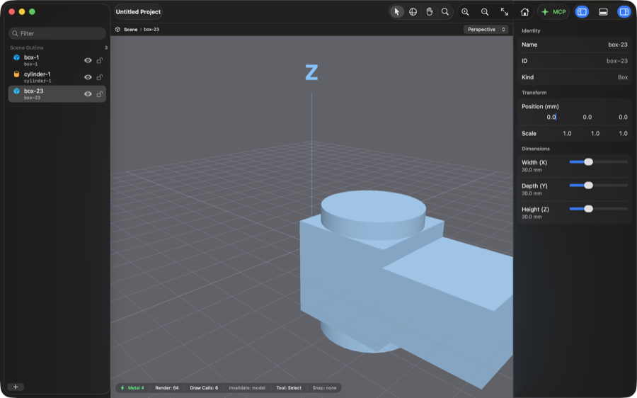
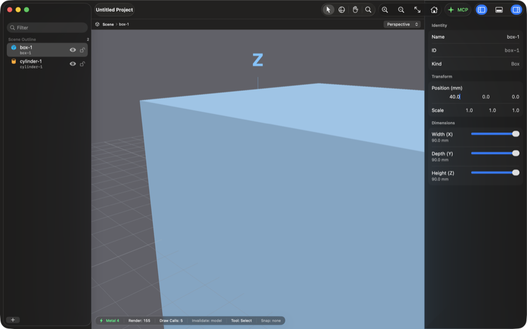
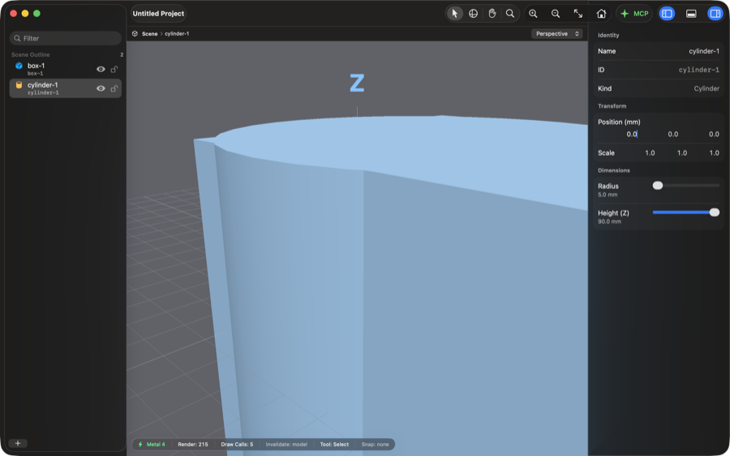
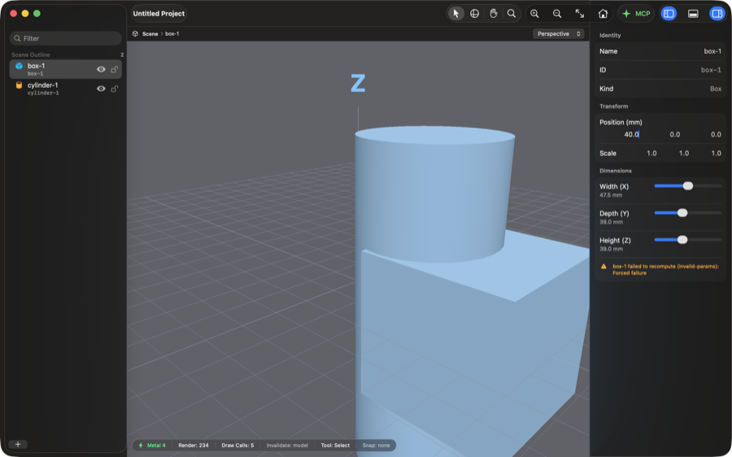
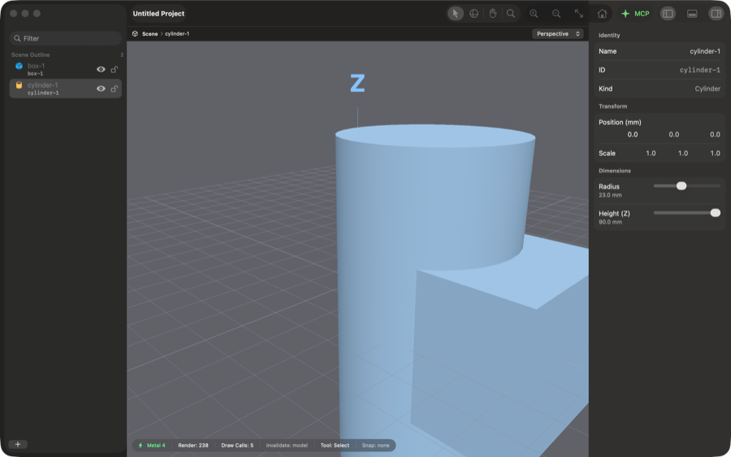
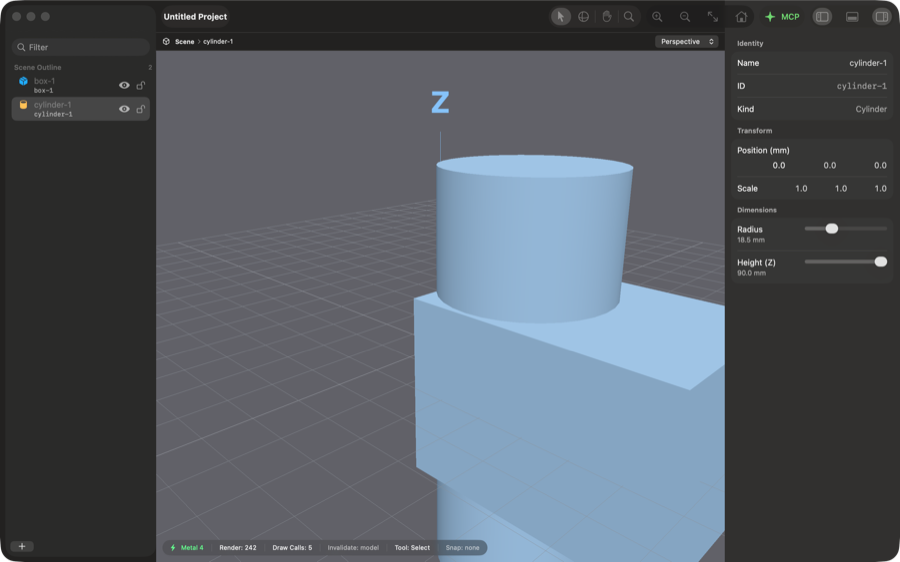
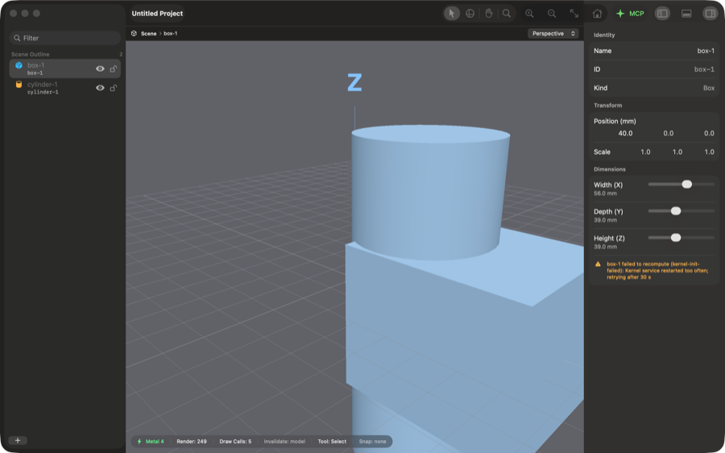
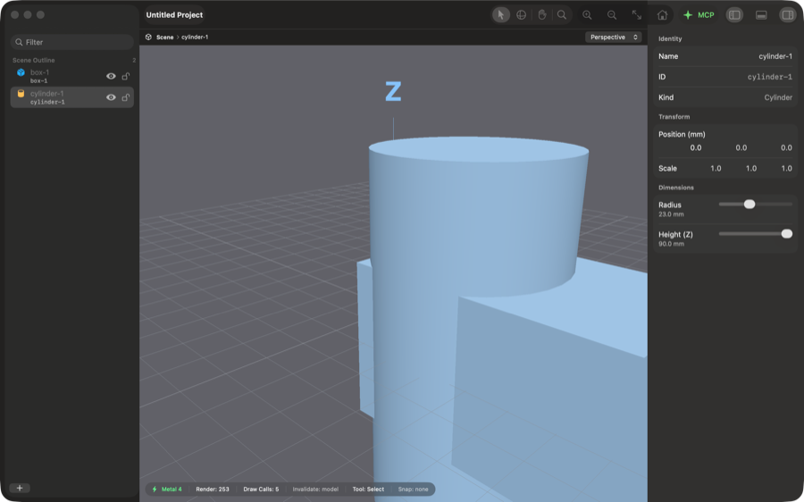

# Manual app checks for the Phase 2 fixes (2026-10-13)

This record covers the five manual checks named by PRs #436 to #440 and left unrun by the Phase 2 backlog run (#444). Each section lists the steps, the observed values, and the outcome. All five checks passed. Two new defects and one known gap surfaced, and the findings section lists them.

## Setup

The checks ran against commit `592e131` on macOS 26.7.1 (build 25G241), Apple silicon.

- **Build.** `make bundle` produced a debug `Made.app` with `Contents/XPCServices/MadeKernelService.xpc`. The Debug menu was present.
- **Launch.** The stage started `Made.app/Contents/MacOS/MadeApp` directly (PID 76345). Its kernel service started as PID 76389.
- **Control.** System Events accessibility (AX) calls through `osascript` drove the Navigator, the Inspector, and the menus. SwiftUI sliders ignore an AX `set value`, so slider moves used `AXIncrement` and `AXDecrement`. One action moves a slider by one tenth of its range. The Navigator Delete item lives in a context menu, which a posted right-click opened.
- **MCP.** The MCP window's Start Server button started the TCP listener on port 9820. A Python client sent `initialize` and one `tools/call` per connection.
- **Evidence.** A `log stream` capture of subsystem `com.made.app` ran from 04:55:00 local time. The other channels were AX reads, MCP replies, the status heads-up display (HUD) render count, window screenshots, and `ps -o rss=`.

Screenshots were downscaled to 900 px wide. The log excerpt in `made-app.log` omits the 187 `Updated … to …` parameter lines.

Table 1 lists each check and its outcome.

Table 1. Outcomes of the five manual checks, 2026-10-13

| Check | Issue | PR | Outcome | Evidence |
| --- | --- | --- | --- | --- |
| Transform edit during a recompute | #92 | #436 | pass | `92-race-window-x40.png`, `92-race-snapshot-x-10.png` |
| Removal frees the kernel cache | #93 | #437 | pass | `93-readd-after-20-cycles.png`, `made-app.log` |
| Parameter clamping | #104 | #438 | pass | `104-box-sliders-at-max.png`, `104-mcp-clamp-viewport-stale.png` |
| Debug > Fail Next Recompute | #109 | #439 | pass | `109-forced-failure.png`, `109-failure-cleared.png` |
| Parameter edits after a kernel-service restart | #245 | #440 | pass | `245-edit-after-segv.png`, `245-edit-after-abrt.png`, `245-breaker-open.png`, `245-breaker-closed.png` |

Evidence files are in `docs/reviews/assets/2026-10-13-manual-app-checks/`.

## #92 transform edit during a recompute: pass

**Steps.** With `box-1` selected, one `osascript` call pressed `AXIncrement` or `AXDecrement` on the Width slider. The same call then committed a new Inspector position X with Return. The check ran seven times.

- Run 1 (X = 25) was untimed.
- Runs 2 to 4 (X = -10, 40, 12.5) typed the value after the slider move. The script measured 124 to 174 ms from the slider action to Return.
- Runs 5 to 7 (X = 25, -10, 40) typed the value first, so only Return followed the slider action. The measured gaps were 113, 85, and 72 ms.

The timer itself costs about 14 ms, so the fastest edit landed about 58 ms after the parameter change. That is inside the 60-ms debounce, before the recompute result could apply.

**Observations.** One second after each run, the Inspector X field, the `cad_get_scene` position, and the typed X value agreed in all seven runs. The width readout matched the slider in every run, for example 57.0 mm in run 7. The window screenshot from run 7 shows the box moved to +X at 57.0 mm wide (Figure 1). The MCP snapshot from run 6 shows the box moved to -X.

Figure 1. Main window after race run 7. Inspector X reads 40.0 and Width reads 57.0 mm.

Figure 2. `cad_capture_snapshot` image after race run 6 (X = -10.0 mm, width 65.5 mm).

**Outcome.** Pass. No run showed the pre-edit position after the recompute landed. App-side timing was not instrumented, so only the fastest runs are known to fall inside the race window.

## #93 removal frees the kernel cache: pass

**Steps.** Each of 20 cycles chose Add > Box Solid from the Navigator and waited 0.6 s. The cycle then chose Delete from the new row's context menu. After each cycle the check counted Navigator rows and searched `cad_get_scene` for the deleted ID. A final box was then added. Last, `cad_boolean_operation` ran with a deleted ID as each operand.

**Observations.**

- All 20 cycles (`box-3` to `box-22`) raised the HUD render count by one on add. The Navigator returned to its two solids, and `cad_get_scene` no longer listed the ID.
- The log holds 21 `Added object` and 21 `Removed object` lines, counting one trial cycle on `box-2`. It holds no kernel error line during the loop.
- Kernel service RSS was 9,696 KB before the loop and 10,224 KB after it, a growth of 528 KB.
- The re-added `box-23` rendered as a 30-mm cube at the origin. The render count rose from 63 to 64, and draw calls read 6 with three solids against 5 with two (Figure 3).
- `cad_boolean_operation` with `solidA` = `box-22` returned `isError` with `Boolean union failed: Solid A 'box-22' not found for CSG boolean`. With `solidB` = `box-21`, it returned the matching `Solid B` message.

Figure 3. Main window with `box-23` added after the 20 cycles. The HUD reads Render 64 and Draw Calls 6.

**Outcome.** Pass. RSS is an indirect signal for the cache. The KERN-13 unit tests (`testRepeatedAddAndDisposeLeavesStoresEmpty`, `testDisposeDuringExecutingJobLeavesNoEngineEntry`) assert the stores are empty. No ghost mesh appeared in any screenshot.

## #104 parameter clamping: pass

**Steps.** For `box-1`, each Dimensions slider received 15 decrements, then 15 increments. Each readout was read through AX. `cylinder-1` Radius and Height received the same treatment. MCP `cad_set_param` then set `box-1` width to 500 and to 1, and `cylinder-1` radius to 0.

**Observations.**

- Box Width, Depth, and Height each read 5.0 mm at the minimum and 90.0 mm at the maximum. The AX slider values matched (Figure 4).
- Cylinder Radius read 5.0 and 50.0 mm, and Height read 5.0 and 90.0 mm.
- Across every `Updated box-1` and `Updated cylinder-1` log line, the smallest value was 5.0 and the largest 90.0.
- `cad_measure` after the maximum drag returned box bounds of 90 by 90 by 90 mm and a cylinder of radius 50 mm and height 90 mm.
- MCP width 500 stored 90, width 1 stored 5, and radius 0 stored 5, read back through `cad_get_scene`. After reselecting each object, the Inspector read Width 5.0 mm and Radius 5.0 mm.

Figure 4. `box-1` with Width, Depth, and Height at 90.0 mm.

**Edge case, MCP edit not recomputed.** The render count stayed at 215 across the three MCP edits and the reselects. The viewport still showed the 50-mm-radius cylinder while the Inspector read 5.0 mm (Figure 5). Open issue #132 covers this gap, so no new finding was filed. The `cad_set_param` reply echoed the raw input (`to 500.0`), which a 2026-10-12 finding already records.

Figure 5. Main window after MCP `cad_set_param` set the radius to 0. The Inspector reads 5.0 mm, and the viewport still shows the 50-mm cylinder.

**Outcome.** Pass. Every value stayed within 5 to 90 mm for box sides and cylinder height, and within 5 to 50 mm for the radius.

## #109 Debug > Fail Next Recompute: pass

**Steps.** The check chose Debug > Fail Next Recompute through the menu bar and moved the `box-1` Width slider once. It read the Dimensions section through AX, took a screenshot, then moved the slider once more.

**Observations.**

- The log recorded `Next recompute will fail with invalid-params` at 05:00:26.571.
- After the first move (39.0 to 47.5 mm), the render count stayed at 234. The Inspector showed `box-1 failed to recompute (invalid-params): Forced failure`, and the 39.0-mm box stayed on screen (Figure 6).
- The log carried the same message at error level at 05:00:27.826.
- After the second move (56.0 mm), the render count rose to 235 and the warning row was gone. `cad_measure` returned an X bound of 56.0 mm (Figure 7).

Figure 6. Inspector warning row after the forced failure. Width reads 47.5 mm while the previous box remains.

Figure 7. The second slider move clears the row, and the box widens to 56.0 mm.

**Outcome.** Pass. The recipe in `docs/guides/testing.md` matched what the app did.

## #245 parameter edits after a kernel-service restart: pass

**Steps.** The check sent `kill -SEGV` to the kernel service and waited for a new PID. It then moved the `box-1` Width and `cylinder-1` Radius sliders. After 52 s it repeated the sequence with `kill -ABRT`. Last, it sent three `kill -SEGV` signals inside 30 s and edited during and after the breaker window.

**Observations, single restarts.**

- SEGV on PID 76389 produced PID 81139 within 0.5 s. The log shows one `Kernel service restarted (crashed); regenerating solids` line at 05:00:45.073.
- After that restart, the Width edit raised the render count from 236 to 237, and `cad_measure` returned 47.5 mm. The Radius edit raised it to 238 and returned 23 mm (Figure 8).
- ABRT on PID 81139 at 05:01:37 produced PID 83118 within 0.5 s, with one restart line at 05:01:37.959. Width then read 56.0 mm and Radius 18.5 mm, each with a render-count rise and a matching `cad_measure` bound (Figure 9).

Figure 8. Main window after the SEGV restart and two slider edits. Radius reads 23.0 mm.

Figure 9. Main window after the ABRT restart and two slider edits.

**Observations, breaker.** The first attempt spaced the kills 1 s apart. After the second kill, no new service process appeared until 05:02:31, 10 s after the previous launch, so the third kill was not sent. The second attempt waited for each relaunch.

- Kills landed at 05:03:01, 05:03:02, and 05:03:12. Relaunches took 1 s and about 10 s.
- The log shows two restart lines. After the third kill, no restart line appeared and no service process was running.
- A Width edit at 05:03:15 showed `box-1 failed to recompute (kernel-init-failed): Kernel service restarted too often; retrying after 30 s` in the Inspector and the log (Figure 10).
- At 05:03:53, 41 s after the third kill, a Width edit launched PID 89360. The log recorded a restart line at 05:03:54.394, the render count rose from 249 to 252, Width read 64.5 mm, and the warning cleared. A Radius edit then raised the count to 253 (Figure 11).

Figure 10. Inspector warning while the breaker is open, 3 s after the third kill.

Figure 11. Main window after the 30-s window passed and one edit relaunched the service.

**Outcome.** Pass. Each single restart logged once, regenerated both solids, and accepted later edits. The breaker opened on the third restart inside 30 s and closed after the window. The `--mcp-stdio` variant was not run, because of the 64-KiB `runStdio` finding in `docs/parked-findings.md`.

## Findings

The checks surfaced two new defects. Both are logged in `docs/parked-findings.md` under 2026-10-13.

1. While the breaker is open, the third restart is never emitted. An edit rejected with `kernel-init-failed` leaves the document and the viewport out of step until the next edit after the 30-s window (`XPCKernelEngine.swift:185`).
2. After a second crash inside 10 s, the relaunch waited about 9 s in both observed runs, consistent with the launchd respawn throttle. The Inspector gives no sign that regeneration is pending (`XPCKernelEngine.swift:120`).

The MCP parameter edit that does not recompute the GUI viewport is covered by #132.

## Teardown

The app quit through Command-Q within 5 s, and its kernel service exited with it. The log capture was stopped by PID. Afterward, `pgrep -fl 'MadeApp|MadeKernelService'` and `pgrep -fl "log stream"` returned nothing.
